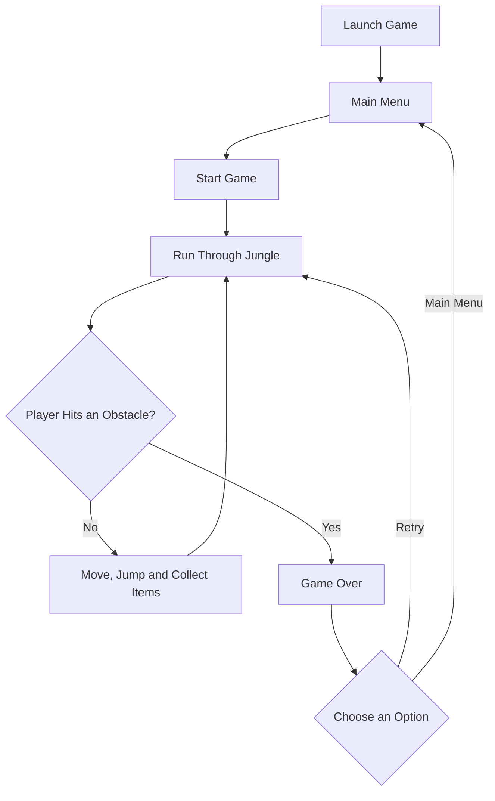
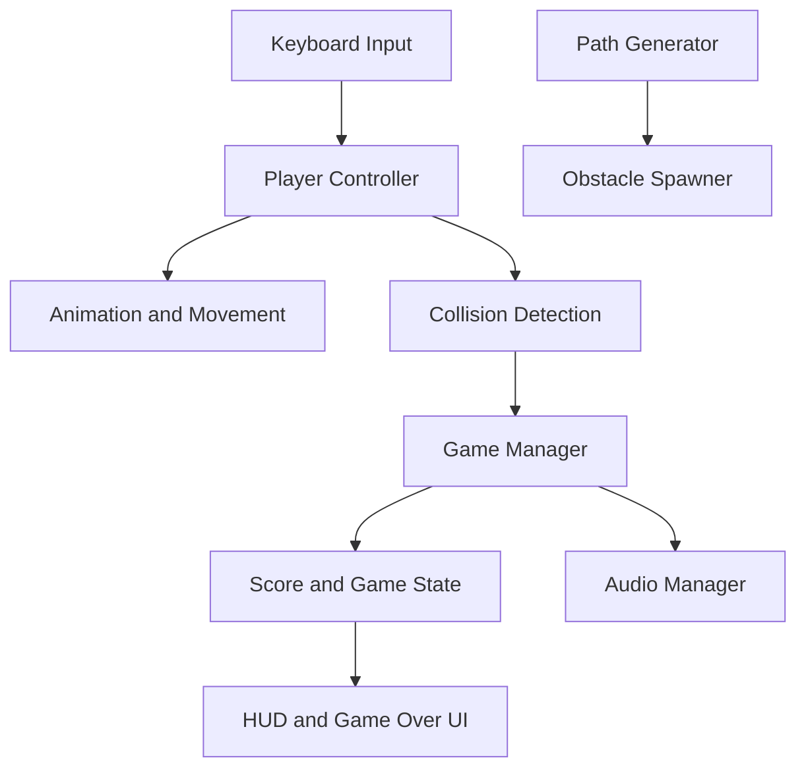

# Jungle Runner – Endless Runner Game

A 3D jungle-themed endless runner developed using **Unity 6.6** and **C#**. The player controls the Explorer character, moves along a continuous path, avoids obstacles, and collects coins and gems to achieve a high score.

## Game Overview

Jungle Runner is designed around simple controls and quick reactions. The player runs through a jungle environment and must avoid hazards such as rocks, logs, crates, trees, and stone blocks. The game includes a main menu, an instructions panel, gameplay controls, collectible items, and a game-over screen.

## Features

- 3D jungle environment and continuous running path
- Explorer player character
- Left, right, and jump controls
- Obstacles and collision detection
- Coin and gem collection
- Score, distance, and best-score display
- Main menu and instructions screen
- Pause, retry, and return-to-menu options
- Separate C# scripts for the main game systems

## Controls

| Key | Action |
|---|---|
| `A` or `←` | Move left |
| `D` or `→` | Move right |
| `Space` | Jump |
| `Esc` | Pause |

## Technologies Used

| Technology | Purpose |
|---|---|
| Unity 6.6 | Game engine and development environment |
| C# | Gameplay programming |
| Unity Editor | Scene creation, asset setup, and testing |
| Unity UI / TextMesh Pro | Menus, instructions, and HUD |

## Project Structure

```text
JungleRunner/
├── Assets/
│   ├── Animations/
│   ├── Audio/
│   ├── Materials/
│   ├── Models/
│   ├── Prefabs/
│   ├── Scenes/
│   ├── Scripts/
│   ├── Textures/
│   └── UI/
├── Packages/
├── ProjectSettings/
└── README.md
```

*Folder names may vary slightly depending on the final Unity project.*

## Main Scripts

| Script | Responsibility |
|---|---|
| `PlayerController.cs` | Handles player movement and input |
| `GameManager.cs` | Manages the game state and run lifecycle |
| `EndlessPathGenerator.cs` | Generates and manages path segments |
| `ObstacleSpawner.cs` | Places obstacles on the route |
| `ObstacleCollision.cs` | Handles hazard collisions |
| `CoinCollection.cs` | Handles coin collection |
| `GemCollection.cs` | Handles gem collection |
| `CameraFollow.cs` | Controls camera following |
| `HUDUI.cs` | Updates gameplay information |
| `PauseManager.cs` | Handles pause and resume |
| `GameOverUI.cs` | Displays run results and retry options |
| `MainMenuUI.cs` | Controls main menu actions |
| `AudioManager.cs` | Manages game audio |

## Gameplay Flow



## System Architecture



## How to Run the Project

1. Install a compatible version of **Unity Hub** and the Unity Editor.
2. Clone or download this repository.
3. Open Unity Hub and select **Add project from disk**.
4. Choose the folder containing the Unity project.
5. Open the project in Unity.
6. Open the `MainMenu` scene.
7. Press the **Play** button in the Unity Editor.

## Screenshots

Add screenshots from your actual game build in a folder named `Screenshots/`, then update the image paths below.

| Screen | Preview |
|---|---|
| Main Menu | `Screenshots/main-menu.png` |
| Instructions | `Screenshots/instructions.png` |
| Gameplay | `Screenshots/gameplay.png` |
| Game Over | `Screenshots/game-over.png` |

Example:

```markdown

```

## Testing

The game should be tested for:

- Correct response to left, right, jump, and pause inputs
- Player movement staying within the playable route
- Correct obstacle collision behaviour
- Coin and gem counters updating correctly
- Score and distance display
- Game-over, retry, and main-menu behaviour
- Stable performance during longer runs

## Future Enhancements

- Additional jungle environments and obstacle patterns
- More characters and character customisation
- Power-ups and missions
- Achievements and leaderboards
- Improved effects, animations, and sound design

## Project Information

**Project:** Endless Runner Game – Jungle Theme  
**Engine:** Unity 6.6  
**Programming Language:** C#  
**Genre:** 3D Endless Runner

---

*Developed as a game development project using Unity and C#.*
